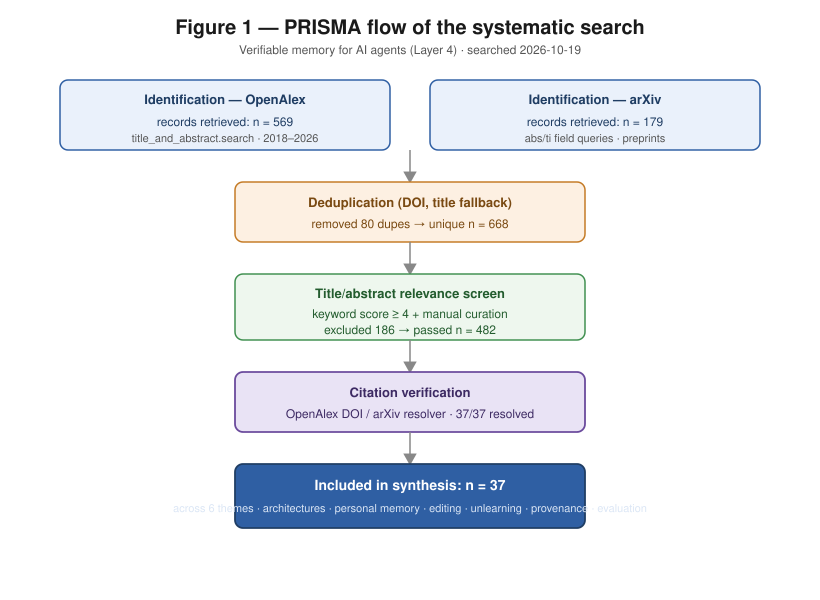
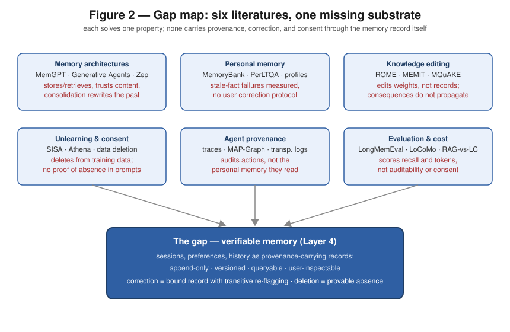

# Verifiable Memory for AI Agents: A Systematic Literature Review

**Scope:** the *memory* layer only (session logs, preference stores, long-term notes as durable, inspectable, correctable records). Action layers and model routing are out of scope and reserved for their own papers.
**Review type:** structured thematic review (scoping + targeted synthesis), method identical to the Qafiya (Layer 1) review.
**Date searched:** 2026-10-19 (Asia/Bangkok). **Window:** 2018-01-01 to 2026-12-31.
**Databases:** OpenAlex (primary), arXiv (preprints). All included citations verified against the OpenAlex DOI resolver / arXiv API.

---

## Abstract

An AI operating system needs a memory that never silently rewrites the past: sessions, preferences, and history stored so the agent remembers, the user can inspect and correct what it remembers, and every correction is itself a bound record. This review maps the six research literatures such a "verifiable memory" must stand on: (1) memory architectures for LLM agents, (2) conversational and personal memory, (3) knowledge editing and correction, (4) forgetting, deletion, and consent, (5) provenance and audit of agent state, and (6) memory evaluation and context cost. From 748 records we screened 482 and synthesised 37 verified works. The central finding is that these communities have each solved one property of the target system and left the combination untouched: memory architectures store and retrieve but treat stored content as trusted once written; editing work corrects *model weights*, not *user-owned memory records*, and shows corrections fail to propagate to dependent conclusions; unlearning work deletes from training data, not from live agent state; provenance work logs actions, not the memory those actions were read from; and benchmarks score recall, not auditability. No surveyed work defines a memory substrate in which sessions, preferences, and history are **provenance-carrying records** — append-only, versioned, queryable — such that a user correction transitively invalidates dependent outputs and a deletion is provably absent from later prompts. We state that gap as the layer's novelty claim and outline the evidence needed to defend it.

## 1. Introduction and research questions

LLM agents now ship with "memory" as a product feature, and the research literature on agent memory has grown quickly since MemGPT. But memory that a user cannot inspect, correct, or erase with confidence is a liability, not a capability: stale preferences silently steer outputs, and corrections to one fact leave dependent conclusions unrevised. This review reorganises the literature around a single question.

**Primary RQ.** *What prior work exists toward a memory substrate for AI agents in which sessions, preferences, and history are durable, user-inspectable, correctable, and auditable records — and where is the integration gap?*

Sub-questions:

- **RQ1 (architecture).** How do memory-augmented agents structure storage and retrieval (working/episodic/semantic memory, virtual context, knowledge graphs)?
- **RQ2 (personal memory).** How is user-specific long-term memory (preferences, profile, history) built and used in conversational agents?
- **RQ3 (correction).** What methods exist to correct stored knowledge, and do corrections propagate to dependent conclusions?
- **RQ4 (forgetting).** What methods delete data with guarantees, and have they been applied to live agent memory rather than training corpora?
- **RQ5 (provenance).** How is agent state logged or audited, and is *memory* (not only actions) covered?
- **RQ6 (evaluation & cost).** How is agent memory benchmarked, and what is the measured cost of selective memory loading vs full-history prompting?

## 2. Methods

### 2.1 Search strategy

Two reachable databases were queried programmatically (queries executed 2026-10-19): **OpenAlex** `title_and_abstract.search` and **arXiv** `abs:`/`ti:` field queries, both restricted to 2018–2026 and sorted by relevance. Six concept blocks were used; representative strings:

| Block | Example query strings |
|---|---|
| Memory architectures | `memory "large language model" agent`, `"MemGPT"`, `agent "long-term memory" LLM` |
| Conversational/personal memory | `dialogue "long-term memory" language model`, `"user preferences" LLM agent memory` |
| Editing & correction | `knowledge editing "language model"`, `model editing ROME MEMIT`, `belief revision language model` |
| Forgetting & consent | `machine unlearning "language model"`, `"right to be forgotten" machine learning`, `data deletion GDPR` |
| Provenance & audit | `provenance "language model" agent`, `audit trail AI agent`, `append-only tamper-evident log` |
| Evaluation & cost | `benchmark "long-term memory" agent`, `long context versus retrieval augmented`, `token cost context` |

### 2.2 Screening and inclusion

Records were deduplicated by DOI (title fallback), then screened by a keyword-relevance score over title+abstract against the agent-memory topic (threshold ≥ 4), followed by manual curation to works that materially inform the memory substrate. **Exclusion:** continual-learning catastrophic-forgetting work retained only where the *deletion guarantee* idea transfers; domain-specific unlearning (federated, medical, graph) retained only where the verification method transfers; knowledge-editing work on multimodal/diffusion models excluded as off-scope. Canonical works known to the authors but not surfaced by the query strings (e.g. Generative Agents, Lost in the Middle) were added and verified through the same resolver pipeline.

### 2.3 PRISMA flow

| Stage | n |
|---|---|
| Identified — OpenAlex | 569 |
| Identified — arXiv | 179 |
| **Total identified** | **748** |
| After deduplication | 668 |
| Passed relevance screen | 482 |
| **Included in synthesis** | **37** |

### 2.4 Citation verification

Every included identifier was resolved against OpenAlex (DOI) or the arXiv API and canonical metadata (title, year, venue, authors) retrieved programmatically; one initial duplicate (two identifier forms for the same paper) was merged. All 37 included works resolved successfully. Author lists are reported as returned by the registries and should be spot-checked at final typesetting.

## 3. Results — thematic synthesis

### 3.1 Memory architectures for LLM agents (RQ1)

The founding system is **MemGPT** [1], which borrows OS virtual-memory paging to manage an LLM's context: a working context, recall storage, and archival storage, with the model itself issuing function calls to page memory in and out. **Generative Agents** [2] established the retrieval-side triad — recency, relevance, importance — plus periodic reflection that consolidates episodes into higher-level summaries. Subsequent work systematises the design space: a TOIS survey [3] taxonomises memory sources, forms, and operations across LLM agents, and **Memory Matters** [4] documents empirically that long-term memory is the weak point of LLM-agent pipelines. Architectural variants keep appearing: **Zep** [5] stores agent memory as a temporal knowledge graph whose facts carry validity intervals; **Agentic Memory** [6] learns a unified policy over short- and long-term stores; and the CHI line [7] begins to ask what *usable, privacy-respecting* memory means for end users — the closest existing work to the user-facing inspection view this layer requires.

*Synthesis.* The storage-and-retrieval problem is well explored, including temporal validity [5] and user-facing concerns [7]. But across this block, once content is written to memory it is **trusted**: no architecture carries provenance for a memory item (which session, which user statement, which source produced it), and none treats a user correction as an event that must invalidate anything derived from the corrected item. Consolidation (reflection in [2], graph fusion in [5]) actively *rewrites* the past without retaining the original as an auditable record.

### 3.2 Conversational and personal memory (RQ2)

The personal-memory thread builds stores of user facts and preferences. **MemoryBank** [8] appends dialogue summaries with an Ebbinghaus forgetting curve; evolving conditional memory [11] and graph-based variants build structured user profiles. Benchmarks and datasets — **PerLTQA** [9], work on memory construction and retrieval for personalised agents [10], and a strong recent baseline [12] — show that construction quality (what to extract and store) dominates retrieval quality. Evaluations of long-term memory in deployed-style assistants [13] confirm memory improves personalisation but degrades on conflicting or updated facts.

*Synthesis.* This literature proves the *value* of personal memory and begins to measure its failure modes — notably **stale memory**: when a user's situation changes, the store keeps serving the old fact [13]. What it does not provide is a *correction protocol*: the user has no sanctioned operation that says "this memory is wrong; fix it and everything that followed from it." Preferences are extracted, never bound to the utterance they came from.

### 3.3 Knowledge editing and correction (RQ3)

A mature literature edits factual knowledge *inside model weights*: the seminal editing framework of De Cao et al. [14], locate-and-edit **ROME** [15] and mass-editing **MEMIT** [16], with a comprehensive survey [17]. Two findings matter directly for this layer. First, **ripple effects**: editing one fact fails to update logically entailed beliefs [18], and multi-hop benchmarks (**MQuAKE** [19]) show edited models cannot reason through the consequences of the edit. Second, **scale breaks edits**: sequential editing leads to gradual and catastrophic forgetting of unrelated knowledge [20].

*Synthesis.* This is the strongest formal precedent for the correction problem, and its verdict is sobering: correction *inside the model* is unreliable and non-propagating. The implication for this layer is architectural — corrections should be applied to an **explicit, external memory record** where dependent artifacts are enumerable and can be re-flagged (transitive invalidation), precisely what weight-space editing cannot do. No editing work operates on user-owned agent memory stores.

### 3.4 Forgetting, deletion, and consent (RQ4)

Deletion with guarantees comes from the unlearning literature: data-deletion theory [21], selective forgetting in deep networks [22], shard-and-retrain **SISA** [23], and probabilistic *verification* of unlearning (**Athena** [24]). LLM-specific surveys [25] and personal-data quantification for right-to-be-forgotten requests [26] bring this to language models.

*Synthesis.* The guarantees this literature provides are about **training data in weights**, achieved at significant compute cost, and verified probabilistically. Agent memory is a different and easier target: it is an *external store*, so deletion can be exact — but then the obligation shifts to **provenance**: later prompts and outputs must be provably free of the deleted item. No surveyed work combines exact deletion of memory records with an auditable proof of absence from subsequent agent behaviour; that combination is this layer's consent/forgetting experiment.

### 3.5 Provenance, audit, and transparency of agent state (RQ5)

Agent-side auditing is nascent. A 2026 survey [27] maps evidence tracing and execution provenance for LLM agents — tool calls, plans, and action traces. **MAP-Graph** [28] adds provenance to *shared* memory across multi-agent workflows, the only surveyed work that attaches lineage to agent memory content. Outside agents, transparency-log practice (signed, append-only, tamper-evident logs, as in supply-chain security [29]) supplies the classical mechanism for proving a record was not rewritten.

*Synthesis.* Provenance is being attached to what agents *do*, and in one case to what agents *share* — but not to the **personal memory a single agent reads and writes over time**: sessions, preferences, and history as versioned, provenance-carrying records that survive inspection. The mechanism (append-only, tamper-evident logging [29]) is mature elsewhere; its application as the *data model* of agent memory does not appear.

### 3.6 Evaluation and context cost (RQ6)

Benchmarks now measure agent memory directly: **LongMemEval** [30] tests chat assistants on long-term interactive memory; **LoCoMo** [31] evaluates very-long-term conversational memory; a 2026 benchmark [34] measures personalised agents from recall through forgetting; **AgentMemBench** [36] systematises memory-management strategies; and a cost-aware study [35] asks *when* memory helps relative to its token cost. On the context side, **Lost in the Middle** [33] shows long contexts are used unevenly, a comprehensive study [32] compares retrieval vs long-context prompting and finds retrieval cheaper and competitive, and context-compression methods [37] reduce token cost directly.

*Synthesis.* The evaluation infrastructure measures **recall quality and, recently, cost** — but not auditability, correction propagation, or provable absence after deletion. The cost evidence ([32], [35], [37]) directly licenses this layer's third experiment: selective memory loading vs full-history prompting, measured in tokens, reusing the Qafiya efficiency protocol.

## 4. The gap and the layer's novelty claim

The six literatures each solve one property and leave the seams open:

- Memory architectures store and retrieve but trust whatever was written; consolidation rewrites the past without an auditable original [1–6].
- Personal memory proves value and exhibits stale-fact failure, but offers no user correction protocol [8–13].
- Knowledge editing corrects weights, cannot propagate consequences, and degrades at scale — an argument for correcting *records*, not *parameters* [14–20].
- Unlearning deletes from training data at high cost; no work pairs exact deletion of external memory with a proof of absence from later prompts [21–26].
- Agent provenance covers actions and shared multi-agent state, not personal memory; tamper-evident logging is mature but unapplied here [27–29].
- Benchmarks score recall and cost, not auditability, correction propagation, or consent [30–37].

**Novelty claim (defensible).** *We propose a memory layer in which sessions, preferences, and history are stored as provenance-carrying records in an append-only, versioned, queryable substrate — so that (i) the user can inspect everything the agent remembers, (ii) a user correction is itself a bound record and transitively re-flags all dependent outputs, and (iii) a deleted memory is provably absent from later prompts — with measured token-cost evidence that selective loading beats full-history prompting.* The contribution is the integration and the elevation of correction and consent into the memory data model, not any one component.

**Closest neighbours to differentiate explicitly:** [1] (MemGPT — memory paging, no provenance or correction semantics), [5] (Zep — temporal validity intervals, closest on versioning, but no user correction protocol or deletion proof), [18]/[19] (editing — weight-space, non-propagating; motivates record-space correction), [28] (MAP-Graph — provenance for shared multi-agent memory, not personal inspectable memory), [7] (usable privacy-preserving memory — user study framing, no auditable substrate).

## 5. Evidence required to defend the claim (next steps)

A verifiable-memory paper is credible with: (a) a **formal spec** of the memory schemas (session log, preference store, long-term notes) with provenance, versioning, and correction-event fields, expressed as Qafiya datasets; (b) a **prototype** demonstrating remember → inspect ("what do you remember about me") → correct → dependent re-flag, and delete → proof of absence; (c) the three **frozen experiments** from the layer instructions: correction integrity (transitive invalidation), forgetting/consent (provable absence), and cost (selective loading vs full history, token evidence per the Qafiya efficiency protocol). Honesty-as-architecture requires reporting what the layer provably cannot do — e.g. it cannot retract information already baked into model weights, only from the record substrate.

## 6. Limitations of this review

Single-pass automated search on two databases; relevance screening used a keyword score plus manual curation rather than dual independent review, so recall is bounded by the query strings. The 482→37 curation step is judgment-based and documented in `screen.py` output. Commercial agent-memory products (hosted memory APIs) are covered only where a verifiable publication exists. Several 2026 items are recent preprints not yet peer-reviewed. Author metadata is registry-derived and should be re-checked at typesetting. These bound the review's completeness, not the direction of the gap, which is corroborated independently across all six themes.

## 7. References

1. Packer, C., Wooders, S., Lin, K., et al. (2023). *MemGPT: Towards LLMs as Operating Systems.* arXiv. https://doi.org/10.48550/arXiv.2310.08560
2. Park, J. S., O'Brien, J. C., Cai, C. J., et al. (2023). *Generative Agents: Interactive Simulacra of Human Behavior.* arXiv. https://doi.org/10.48550/arXiv.2304.03442
3. Zhang, Z., Dai, Q., Bo, X., et al. (2025). *A Survey on the Memory Mechanism of Large Language Model-based Agents.* ACM TOIS. https://doi.org/10.1145/3748302
4. Hatalis, K., Christou, D., Myers, J., et al. (2024). *Memory Matters: The Need to Improve Long-Term Memory in LLM-Agents.* AAAI Symposium Series. https://doi.org/10.1609/aaaiss.v2i1.27688
5. Rasmussen, P., Paliychuk, P., Beauvais, T., et al. (2025). *Zep: A Temporal Knowledge Graph Architecture for Agent Memory.* arXiv. https://doi.org/10.48550/arXiv.2501.13956
6. Yu, Y., Yao, L., Xie, Y., et al. (2026). *Agentic Memory: Learning Unified Long-Term and Short-Term Memory Management for Large Language Model Agents.* ACL. https://doi.org/10.18653/v1/2026.acl-long.981
7. Mekioussa Malki, L. (2026). *Towards Usable, Privacy Respecting Long-Term Memory for LLM-based Conversational Agents.* ACM CHI EA. https://doi.org/10.1145/3772363.3799198
8. Zhong, W., Guo, L., Gao, Q., et al. (2023). *MemoryBank: Enhancing Large Language Models with Long-Term Memory.* arXiv. https://doi.org/10.48550/arXiv.2305.10250
9. Du, Y., Wang, H., Zhao, Z., et al. (2024). *PerLTQA: A Personal Long-Term Memory Dataset for Memory Classification, Retrieval, and Synthesis in Question Answering.* arXiv. https://doi.org/10.48550/arXiv.2402.16288
10. Pan, Z., Wu, Q., Jiang, H., et al. (2025). *On Memory Construction and Retrieval for Personalized Conversational Agents.* arXiv. https://doi.org/10.48550/arXiv.2502.05589
11. Yuan, R., Sun, S., Li, Y., et al. (2023). *Personalized Large Language Model Assistant with Evolving Conditional Memory.* arXiv. https://doi.org/10.48550/arXiv.2312.17257
12. Zhou, S., Han, J. (2025). *A Simple Yet Strong Baseline for Long-Term Conversational Memory of LLM Agents.* arXiv. https://doi.org/10.48550/arXiv.2511.17208
13. Jia, Z., Liu, Q., Li, H., et al. (2025). *Evaluating the Long-Term Memory of Large Language Models.* ACL Findings. https://doi.org/10.18653/v1/2025.findings-acl.1014
14. De Cao, N., Aziz, W., Titov, I. (2021). *Editing Factual Knowledge in Language Models.* EMNLP. https://doi.org/10.18653/v1/2021.emnlp-main.522
15. Meng, K., Bau, D., Andonian, A., et al. (2022). *Locating and Editing Factual Associations in GPT (ROME).* arXiv. https://doi.org/10.48550/arXiv.2202.05262
16. Meng, K., Sharma, A. S., Andonian, A., et al. (2022). *Mass-Editing Memory in a Transformer (MEMIT).* arXiv. https://doi.org/10.48550/arXiv.2210.07229
17. Wang, S., Zhu, Y., Liu, H., et al. (2024). *Knowledge Editing for Large Language Models: A Survey.* ACM Computing Surveys. https://doi.org/10.1145/3698590
18. Cohen, R., Biran, E., Yoran, O., et al. (2024). *Evaluating the Ripple Effects of Knowledge Editing in Language Models.* TACL. https://doi.org/10.1162/tacl_a_00644
19. Zhong, Z., Wu, Z., Manning, C. D., et al. (2023). *MQuAKE: Assessing Knowledge Editing in Language Models via Multi-Hop Questions.* EMNLP. https://doi.org/10.18653/v1/2023.emnlp-main.971
20. Gupta, A., Rao, A., Anumanchipalli, G. (2024). *Model Editing at Scale leads to Gradual and Catastrophic Forgetting.* ACL Findings. https://doi.org/10.18653/v1/2024.findings-acl.902
21. Ginart, A., Guan, M. Y., Valiant, G., et al. (2019). *Making AI Forget You: Data Deletion in Machine Learning.* arXiv. https://doi.org/10.48550/arXiv.1907.05012
22. Golatkar, A., Achille, A., Soatto, S. (2020). *Eternal Sunshine of the Spotless Net: Selective Forgetting in Deep Networks.* IEEE CVPR. https://doi.org/10.1109/cvpr42600.2020.00932
23. Bourtoule, L., Chandrasekaran, V., Choquette-Choo, C. A., et al. (2019). *Machine Unlearning (SISA).* arXiv. https://doi.org/10.48550/arXiv.1912.03817
24. Sommer, D., Song, L., Wagh, S., et al. (2022). *Athena: Probabilistic Verification of Machine Unlearning.* Proceedings on Privacy Enhancing Technologies. https://doi.org/10.56553/popets-2022-0072
25. Qu, Y., Ding, M., Sun, N., et al. (2024). *The Frontier of Data Erasure: Machine Unlearning for Large Language Models.* arXiv. https://doi.org/10.48550/arXiv.2403.15779
26. Staufer, D. (2025). *What Should LLMs Forget? Quantifying Personal Data in LLMs for Right-to-Be-Forgotten Requests.* arXiv. https://doi.org/10.48550/arXiv.2507.11128
27. Wang, Y., Zhang, J., Wu, Z., et al. (2026). *From Agent Traces to Trust: A Survey of Evidence Tracing and Execution Provenance in LLM Agents.* arXiv. https://doi.org/10.48550/arXiv.2606.04990
28. Wang, Y., Yan, Z., Zhang, J., et al. (2026). *MAP-Graph: Provenance-Aware Shared Memory for Multi-Agent Workflows.* arXiv. https://doi.org/10.48550/arXiv.2608.10509
29. Blauzvern, H. (2023). *Nowhere to Hide: Using Transparency Logs to Secure Your Supply Chain.* ACM. https://doi.org/10.1145/3689944.3696349
30. Wu, D., Wang, H., Yu, W., et al. (2024). *LongMemEval: Benchmarking Chat Assistants on Long-Term Interactive Memory.* arXiv. https://doi.org/10.48550/arXiv.2410.10813
31. Maharana, A., Lee, D.-H., Tulyakov, S., et al. (2024). *Evaluating Very Long-Term Conversational Memory of LLM Agents (LoCoMo).* arXiv. https://doi.org/10.48550/arXiv.2402.17753
32. Li, Z., Li, C., Zhang, M., et al. (2024). *Retrieval Augmented Generation or Long-Context LLMs? A Comprehensive Study and Hybrid Approach.* arXiv. https://doi.org/10.48550/arXiv.2407.16833
33. Liu, N. F., Lin, K., Hewitt, J., et al. (2023). *Lost in the Middle: How Language Models Use Long Contexts.* arXiv. https://doi.org/10.48550/arXiv.2307.03172
34. Uddin, M. N., Shubham, K., Blanco, E., et al. (2026). *From Recall to Forgetting: Benchmarking Long-Term Memory for Personalized Agents.* ACL Findings. https://doi.org/10.18653/v1/2026.findings-acl.1337
35. Mishra, S., Mishra, S. (2026). *When Does Memory Help? A Cost-Aware Evaluation of Long-Term Memory in Tool-Using LLM Agents.* arXiv. https://doi.org/10.48550/arXiv.2609.05441
36. Cherif, A. (2026). *AgentMemBench: A Systematic Benchmark for Evaluating Long-Term Memory Management Strategies in Conversational AI Agents.* arXiv. https://doi.org/10.48550/arXiv.2608.00009
37. Chevalier, A., Wettig, A., Ajith, A., et al. (2023). *Adapting Language Models to Compress Contexts.* EMNLP. https://doi.org/10.18653/v1/2023.emnlp-main.232

---
*Reproducibility artifacts:* `search.py` (queries), `raw/openalex.json`, `raw/arxiv.json`, `raw/combined.json`, `screen.py`, `verify.py`, `raw/included_verified.json` (canonical metadata for all 37). Generated 2026-10-19.
